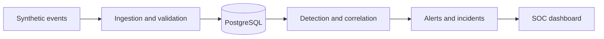

# SentinelForge

**Enterprise Security Monitoring, Threat Detection & Incident Response Lab**

A Python, PostgreSQL and Bash-based SOC lab for security log ingestion, threat detection, event correlation, incident investigation and security analytics. It runs entirely on your own computer and uses synthetic data only.

> **Status: Phase 1 of 9 (foundation).** The event schema, configuration, database setup with a least-privilege role, and the first CLI commands work and are tested. Ingestion, detection, alerts, incidents and the dashboard are built in later phases (see [the roadmap](#roadmap)). This README is expanded with screenshots and verified results as features land.

## What works today

| Feature | Command |
|---|---|
| Validate a JSON Lines file against the common event schema | `sentinelforge events validate FILE` |
| Show normalised events (UTC times, lower-cased names) | `sentinelforge events validate --show-normalised FILE` |
| Create the least-privilege application role and schema | `sentinelforge db bootstrap` |
| Check database connectivity and privileges | `sentinelforge db status` |
| Show configuration with passwords hidden | `sentinelforge config show` |

## Quick start

Free to build and run: Linux, macOS or Windows with WSL 2, Python 3.11+ and PostgreSQL 16. Docker is optional. Full instructions: [docs/installation.md](docs/installation.md) · Costs and licences: [docs/cost-and-licences.md](docs/cost-and-licences.md).

```bash
bash scripts/setup.sh              # virtual environment, dependencies, .env with random passwords
bash scripts/setup_native_db.sh    # first time only: PostgreSQL admin role and database
bash scripts/check_environment.sh  # reports anything missing
bash scripts/start_lab.sh          # starts PostgreSQL, creates the app role, checks it
bash scripts/run_tests.sh --integration
```

## How it fits together



Design details: [docs/architecture.md](docs/architecture.md) · Event format: [docs/event-schema.md](docs/event-schema.md)

## Project layout

```
src/sentinelforge/
    cli.py              sentinelforge command
    config.py           SF_* settings from environment / .env (passwords hidden)
    timeutil.py         strict timestamp parsing, everything in UTC
    events/schema.py    the common SecurityEvent schema
    events/validate.py  JSON Lines file validation
    db/bootstrap.py     least-privilege role and schema setup
    db/status.py        connectivity and privilege check
scripts/                setup, database setup, environment check, start/stop, lint, tests, licence check
tests/unit/             fast tests, no database needed
tests/integration/      tests against a real PostgreSQL server
data/sample/            synthetic example events
docs/                   architecture, event schema, installation, cost and licences
```

## Testing

```bash
bash scripts/run_tests.sh                 # lint + unit tests
bash scripts/run_tests.sh --integration   # also database tests (start the lab first)
```

Integration tests use their own throwaway schema and role (`sf_test`, `sf_test_app`) and remove them afterwards.

## Roadmap

1. **Foundation**: configuration, event schema, database roles *(done)*
2. Synthetic event generator, ingestion and storage
3. Detection rules
4. Correlation, risk scoring and alerts
5. Incident management and reports
6. SOC dashboard (Streamlit)
7. SQL analytics and Bash automation
8. Threat intelligence and optional anomaly detection
9. Quality, documentation and release

## Safety

SentinelForge uses **synthetic data only**. It does not collect real traffic or credentials, does not run malware, and does not contact external systems. Example addresses come from ranges reserved for documentation (RFC 5737). The database listens on `127.0.0.1` only.

## Licence

A licence will be added before the first public release (MIT or Apache-2.0).
